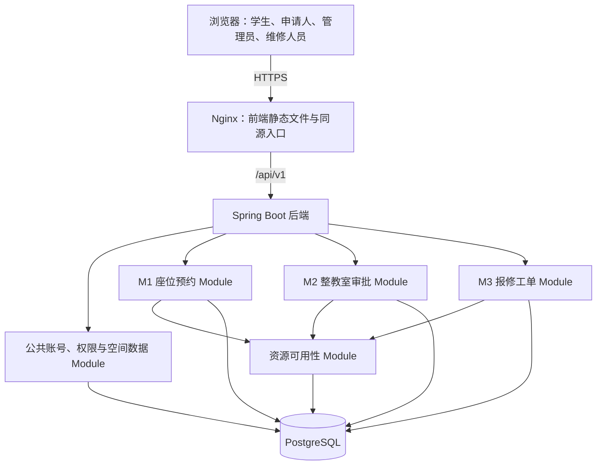

# 校园资源服务平台 MVP 技术方案

版本：0.1；日期：2026年10月10日；状态：技术选型已确定，业务待确认项见第十一节。

依据：[校园资源服务平台 MVP 产品设计](product-design.md) 0.1。本文约定首版技术路线与实现原则，用于拆分开发任务和制定验收标准；具体建表脚本、接口字段和部署配置随实现纳入版本管理。

## 一、目标与范围

首版采用 Web 应用，完成公共账号与权限、M1 座位预约、M2 整教室审批、M3 报修工单，以及三者对座位可用性的联动。学生、申请人、管理员和维修人员使用同一个前端，通过角色展示各自功能。

技术工作的优先级是业务正确性、可演示流程、自动测试和可重复部署。关键目标包括：

- 并发情况下不重复预约，个人预约和整室审批不形成冲突占用。
- 维修下架和审批占用记录来源，解除一项限制时保留其他限制。
- 权限、院系限制、时间和状态校验由服务端执行。
- 未签到预约可在应用重启后继续处理，不重复产生违约记录。
- 数据库变更、测试环境版本和发布结果可追溯到 Git commit。

提醒推送、多级审批、图片附件、统一校园登录和自然语言 Agent 按产品后续迭代安排推进；期末课程要求仍需单独对照任务书验收。

## 二、技术栈与版本策略

| 层次 | 选型 | 使用方式与理由 |
| --- | --- | --- |
| 前端 | Vue 3、TypeScript、Vite | 单页应用，按业务功能组织页面，类型检查随构建执行 |
| 界面 | Element Plus、Vue Router | 提供表单、表格、弹窗与路由；学生端布局兼顾手机浏览器 |
| 状态管理 | Pinia | 保存登录用户和少量跨页面状态，业务记录以服务端查询结果为准 |
| 后端 | Java 21、Spring Boot 4.1 稳定版本、Maven Wrapper | 一个后端进程，使用 Spring Web 提供 HTTP 端点，通过事务协调业务变更 |
| 认证授权 | Spring Security | 预置账号登录、会话管理、角色及记录访问校验 |
| 数据访问 | Spring JDBC | 使用参数化 SQL；显式表达冲突查询、行锁和条件更新，便于审查并发行为 |
| 数据库 | PostgreSQL 18、Flyway | 保存业务数据与约束；以版本化迁移脚本维护结构 |
| 定时处理 | Spring Scheduling | 扫描未签到预约，执行幂等取消与违约记录 |
| 后端测试 | JUnit Jupiter、Spring Boot Test、Testcontainers | 单元测试、真实 PostgreSQL 集成测试及真实 HTTP 测试 |
| 前端测试 | Vitest、Vue Test Utils、Playwright | 交互测试及三条主流程的浏览器验收 |
| 部署 | Docker Compose、Nginx | 统一前端入口、后端和数据库的测试环境配置 |
| 持续集成 | GitHub Actions | 仓库托管在 GitHub 时执行检查、构建和测试；其他平台使用等价流水线 |

Java 21 与上述 Spring Boot 主线兼容，依据为 [Spring Boot 系统要求](https://docs.spring.io/spring-boot/system-requirements.html)。前端项目使用 [Vue 官方基于 Vite 的搭建方式](https://vuejs.org/guide/quick-start)。数据访问使用 [Spring JDBC](https://docs.spring.io/spring-framework/reference/data-access/jdbc/core.html)，数据库迁移遵循 [Spring Boot 的 Flyway 集成说明](https://docs.spring.io/spring-boot/how-to/data-initialization.html)。

项目初始化时锁定框架补丁版本、Node.js 受支持的 LTS 版本、前端包锁文件、Maven Wrapper 和容器镜像版本。依赖采用稳定版本，Spring 相关依赖优先交由 Spring Boot 管理；Flyway 同时配置 PostgreSQL 支持依赖。本地、CI 和测试环境使用相同数据库主版本，镜像避免使用 `latest`。

## 三、总体结构与模块协作

采用前后端分离的模块化单体：一个 Vue 前端、一个 Spring Boot 后端、一个 PostgreSQL 数据库。后端按业务 Module 组织，通过小而明确的 Interface 协作；SQL、锁、限制合并和状态校验保留在各模块的 Implementation 内。



| Module | 负责的行为 | 对外 Interface 的主要能力 |
| --- | --- | --- |
| 公共层 D | 账号、角色、院系、教室、座位、开放时间、参数、签到码和操作日志 | 校验操作者资格，查询或维护空间数据 |
| M1 座位预约 | 预约生命周期、签到、历史、未签到取消和违约 | 创建或取消预约、签到、查询个人记录 |
| M2 整教室审批 | 申请、审批、驳回和撤销 | 提交申请、审批、撤销与查询进度 |
| M3 报修工单 | 上报、派单、维修、完工和验收 | 执行工单状态转换与查询工单 |
| 资源可用性 | 汇总占用来源，执行并发协议，查询和变更有效占用 | 查询可用性、建立占用或限制、按来源解除 |

资源可用性 Module 是占用与限制的统一写入入口。M1、M2、M3 不直接修改对方的业务表，也不自行维护“教室可预约”布尔值。所有业务写操作通过应用事务协调自身状态、占用记录和操作日志；模块协作默认加入同一个事务。

可用性查询只反映查询时的结果，不构成预留承诺。创建预约和审批仍须在事务内重新检查。跨模块 HTTP、远程调用和消息投递不放入上述事务中，以免把网络失败混入数据库一致性协议。

### HTTP 联动验收的技术基线

首版提供真实 HTTP 端点，并使用启动后的后端和真实 PostgreSQL 验证两条跨模块行为链：

1. 调用 M2 审批端点，随后通过 M1 查询与预约端点验证对应时段不可预约；撤销申请后再次验证。
2. 调用 M3 进入维修端点，通过 M1 查询与预约端点验证整室下架；验收后验证只解除对应工单限制。

这些测试验证通过 HTTP 触发的跨模块行为，后端 Module 之间仍为应用内 Interface 调用。产品文档没有明确是否要求后端 Module 彼此经 HTTP 通信，因此这一验收解释属于编码前确认项。若课程要求 M2/M3 向资源模块发起后端 HTTP 调用，必须先调整部署与事务方案，集中资源占用的权威写入入口，并补充幂等与失败恢复设计；不能用两次前端请求替代该要求。

## 四、数据与时间约定

### 主要数据对象

| 对象 | 主要内容与约束 |
| --- | --- |
| 用户、角色、用户角色 | 用户所属院系、启停状态、密码摘要；一个用户可有多个角色 |
| 教室、座位、开放时间 | 教室院系访问规则、开放时段、座位编号和插座标记；编号在所属教室内唯一 |
| 座位预约 | 用户、座位、起止时间、状态、签到时间、取消原因和签到截止时间 |
| 有效座位时段占用 | 按一小时记录 M1 当前有效占用；`座位 ID + 时段开始时间` 唯一，关联预约 |
| 整教室申请 | 申请人、教室、时段、用途、状态、审批人及审批意见 |
| 报修工单 | 上报人、教室、故障内容、分派人员、状态与状态转换时间 |
| 教室限制 | 来源类型、来源记录 ID、教室、有效起止时间、解除时间；M2/M3 各自保存独立来源 |
| 违约记录 | 关联预约、原因、产生时间；同一预约同类违约只保存一次 |
| 每日教室签到码 | 教室、校园日期、码的摘要；同一教室同一天唯一 |
| 写请求结果 | 操作者、动作、请求键、请求摘要和结果；幂等键组合唯一，与成功业务变更一起保存 |
| 操作日志、系统参数 | 操作者、动作、对象、结果、请求标识；单次预约时长等配置 |

业务表保留历史。取消预约时释放有效时段占用，撤销申请或验收工单时标记该来源限制已解除，不删除原始申请、工单和操作记录。

M2 限制覆盖申请的实际时间区间，M3 维修限制从进入维修中开始，结束时间在验收前保持开放。一个教室可同时具有多个维修限制。每个来源只能建立一条对应的有效限制，重复操作不能重复建立或解除其他来源。

### 时间与可用性

- 统一使用校园时区 `Asia/Shanghai` 解释开放时间和每日签到码；业务时间以服务端为准。
- 预约与占用采用半开区间 `[开始时间, 结束时间)`，相邻时段不冲突。数据库业务时间使用带时区时间类型，HTTP 时间使用带偏移的 ISO 8601 表达。
- M1 保持产品规定的整点小时粒度，单次最多 4 小时作为默认系统参数。M2 的时段精度需确认；冲突检查按真实区间执行，不能通过截断时间忽略冲突。
- 座位可用需要同时满足开放时间、院系资格、座位启用、无有效 M1 占用、无相交 M2 限制、无相交 M3 限制。
- 可用性结果可返回权限范围内的限制类型和时段；其他用户的身份、预约用途和故障详情不随搜索结果暴露。
- 停用或调整空间数据时，有效关联预约或申请需要先处理。MVP 默认阻止会使既有有效记录失效的配置修改，并保留历史引用；具体维护权限由服务端控制。

## 五、并发控制与业务状态

### 统一事务协议

所有影响占用或状态合法性的写操作遵守相同协议：

1. 开始 `READ COMMITTED` 隔离级别的数据库事务，获取目标教室的行锁；涉及多间教室时按教室 ID 升序加锁。
2. 在取得锁后通过新的 SQL 查询重新读取业务状态、限制和必要的当前权限数据，处理该教室已逾期但尚未释放的未签到预约；不复用等待锁之前的查询结果。
3. 使用资源可用性 Module 检查时间、开放规则与全部相关占用来源，判断该动作是否允许。
4. 原子更新业务状态、时段占用或来源限制，并写入成功操作日志；任一步失败则回滚全部变更。
5. 提交后返回结果。状态或占用冲突使用稳定业务错误码，不能向用户暴露 SQL 异常。

这一协议覆盖创建、取消、签到、未签到取消、审批、撤销、进入维修、验收，以及会改变资源规则的基础数据维护。查询不持有长事务；短时写事务中不执行网络调用。PostgreSQL 行锁行为依据 [官方锁机制说明](https://www.postgresql.org/docs/current/explicit-locking.html)。若改用保留较早快照的隔离级别，需要重新验证整个冲突协议，不能只调整配置。失败与被拒绝请求写诊断日志，不写成已经成功的业务操作记录。

M1 的唯一约束用于兜底同座位同小时的重复预约；它不能单独防止 M1 与 M2 冲突。预约与审批的互斥由共同的教室锁、锁后重新检查和同一事务保证。首版接受同一教室写操作串行化的取舍，后续只有在测量到瓶颈后再细化锁粒度。

### 主要状态与联动

| 业务 | 状态转换 | 同步资源变化 |
| --- | --- | --- |
| 座位预约 | 待签到 → 已签到；待签到 → 用户取消或未签到取消；有效预约 → 已结束 | 创建时建立时段占用，取消时释放该预约占用；到期后不影响后续时段 |
| 整教室申请 | 待审批 → 已通过或已驳回；待审批/已通过 → 已撤销 | 仅审批通过建立 M2 限制；撤销只解除对应申请限制 |
| 报修工单 | 待派单 → 已派单 → 维修中 → 待验收 → 已验收 | 进入维修中建立 M3 限制，待验收仍保留，验收通过才解除 |

状态名称是实现命名约定。撤销与取消的允许时间范围、验收驳回后的工单去向，按第十一节补充验收标准后实现。接口拒绝跳过必要步骤，维修人员只处理分派给自己的工单。

审批通过前检查个人预约和有效教室限制；首版拟拒绝同一教室与已批准申请相交的新审批，并在第十一节确认后纳入验收标准。维修中能否批准未来申请仍须确认，首版建议维修限制解除前拒绝审批通过。维修启动对已存在预约或申请的处置不作隐式取消，需先确认业务规则。

释放一项限制后重新判断其余来源。两张工单中只验收一张、维修结束但仍有整室占用、撤销整室申请但仍在维修等场景，都不能把座位直接标为可预约。

## 六、登录、权限与 HTTP 约定

首版使用预置账号和服务端 Session 登录。浏览器经 Nginx 同源访问前端与后端，使用 `HttpOnly`、生产环境 `Secure` 和适当 `SameSite` 设置的会话 Cookie，写请求携带 CSRF Token。CSRF 保留 Spring Security 的保护机制，依据 [官方 CSRF 说明](https://docs.spring.io/spring-security/reference/servlet/exploits/csrf.html)。

后端单实例运行，会话可先保存在进程内；应用重启后用户重新登录。密码使用 Spring Security 的自适应哈希，不保存明文。每日教室码只作现场签到校验，必须同时校验当前用户、预约、日期和签到窗口，并限制连续错误尝试。

权限分为操作资格和记录访问两层：固定角色决定能否审批、派单和验收，用户 ID、院系、工单分派关系决定能否访问或修改具体记录。操作者身份从登录上下文取得，不能信任请求提交的用户 ID。前端菜单隐藏只改善体验，不替代服务端校验。

HTTP 统一使用 `/api/v1` 前缀，首版采用普通 REST 端点：

| 能力 | 端点示例 |
| --- | --- |
| 登录、退出、当前用户 | `POST /auth/login`、`POST /auth/logout`、`GET /auth/me` |
| 搜索座位 | `GET /seats/availability` |
| 个人预约 | `POST /reservations`、`GET /reservations/mine`、`POST /reservations/{id}/cancel`、`POST /reservations/{id}/check-in` |
| 教室申请与审批 | `POST /classroom-applications`、`GET /classroom-applications`、`POST /classroom-applications/{id}/approve`、`/reject`、`/withdraw` |
| 报修与工单动作 | `POST /repair-orders`、`GET /repair-orders`、`POST /repair-orders/{id}/assign`、`/start`、`/complete`、`/accept` |
| 基础维护 | 教室、座位、开放时间和系统参数的受限管理端点 |

上述路径均位于 `/api/v1` 下，动作路径的简写沿用同一记录前缀。请求与响应使用独立 DTO，统一参数校验、分页和错误结构。未登录、无权限、输入非法和业务冲突分别使用 401、403、400 和 409；错误返回业务码、简短说明和请求标识。

写请求可携带客户端请求键，服务端按操作者、动作和请求键记录结果，同键不同参数拒绝执行。状态转换使用条件更新，重复请求、超时重试和重复定时任务不能重复产生占用或违约。实际字段和幂等保存周期在接口说明中落实。

## 七、未签到任务与故障恢复

使用 [Spring 内置调度](https://docs.spring.io/spring-framework/reference/integration/scheduling.html)，默认每 30 秒分批检查到达签到截止时间且仍为待签到的预约。任务在启动后补扫到期记录，数据库中的截止时间是恢复依据。

每条预约在独立事务内执行取消、释放占用、登记违约和写操作日志；遵守教室锁协议，取得锁后再次核对状态。首版建议签到采用右端开区间，即当前时间小于截止时间才接受签到，到达截止时间即可超时取消；这一边界规则在第十一节确认后定稿。任务与签到并发时只有符合最终窗口及状态的动作成功，任务不能取消已经有效签到的预约。

可用性查询按同一截止规则排除已逾期未签到预约；后续写操作在锁内补处理相应记录，再判断占用。因此任务暂时停机或扫描延迟不会长期误占座位。该逻辑通过同一个资源 Interface 复用，不能在多个模块中各写一套超时判断。

任务扫描的业务落库延迟目标为一个扫描周期加处理耗时，不能宣称每条记录恰在第 15 分钟的同一瞬间完成写入。重复执行通过预约条件更新和违约唯一约束保证幂等；单条失败记录原因并留待下一次重试，不中断整个批次。

首版不依赖 Redis 延迟队列或消息中间件。提醒、邮件和微信推送后续加入时，应与业务事务解耦，并明确投递失败和重试方式。

## 八、测试与验收

测试随功能提交；修复缺陷时补充能复现该缺陷的测试。业务测试通过模块 Interface 或真实 HTTP 入口观察结果，避免只验证内部方法调用次数。

| 层次 | 重点 |
| --- | --- |
| 单元测试 | 时间区间、权限判定、允许的状态转换、截止时间和限制合并；使用可注入 Clock 控制时间 |
| 数据库集成测试 | Testcontainers 启动真实 PostgreSQL，应用 Flyway 迁移，验证唯一约束、锁、事务回滚与幂等 |
| HTTP 集成测试 | 启动后端并发送真实请求，验证 Session、CSRF、权限、错误返回及跨模块行为 |
| 前端测试 | 表单校验、错误提示、角色导航和关键交互 |
| 浏览器验收 | Playwright 完成预约签到、申请审批、维修验收三条主流程 |
| 工程验证 | 文档链接、迁移新建库与升级、初始化重复执行、构建、部署后健康检查和流程冒烟 |

最低业务验收集合如下，实现时将每条转为自动测试并记录结果。涉及待确认项的用例，在业务规则定稿后确定期望结果：

| 编号 | 必须验证的结果 |
| --- | --- |
| T01 | 两个用户同时预约同座位同小时，只有一个成功；相邻时段可以分别预约 |
| T02 | M1 创建与 M2 审批并发时，不出现相交个人预约与整室占用同时有效 |
| T03 | M2 通过后阻止对应时段的个人预约，驳回不占用，撤销只解除自身限制 |
| T04 | M3 进入维修中后整室下架，提交完工仍下架，验收后只解除对应工单限制 |
| T05 | 两个维修来源逐一解除、维修与审批来源组合解除时，可用性始终正确 |
| T06 | 未签到自动取消并释放全部预约时段，重复扫描只产生一条违约 |
| T07 | 签到与超时任务并发、应用重启补扫、任务失败重试符合截止规则且不误取消 |
| T08 | 院系越权、操作他人预约、非管理员审批、维修人员操作未分派工单均被拒绝 |
| T09 | 写入过程中制造失败，业务状态、占用或限制、违约及成功操作日志一起回滚 |
| T10 | 开放时间、时长参数、整点粒度、每日教室码和签到窗口校验正确 |
| T11 | 初始化脚本重复执行不重复造数据；全新数据库和已有版本数据库迁移均通过 |
| T12 | 三条浏览器流程及第三节所述真实 HTTP 联动链通过 |
| T13 | 重复写请求不重复建记录；按确认后的整室冲突规则测试，首版拟拒绝相交重复批准 |
| T14 | 维修与预约创建并发时，新请求遵守限制；既有记录按确认后的处置规则处理 |

并发测试使用同步屏障协调请求开始时机，核对数据库最终状态，不靠固定休眠推测结果。PostgreSQL 专有行为使用 [Testcontainers PostgreSQL 模块](https://java.testcontainers.org/modules/databases/postgres/) 验证，不用内存数据库替代。修订第十一节的业务决策后，同步扩充对应验收用例。

## 九、部署、流水线与可追溯性

本地和测试环境使用 Docker Compose 组织 Nginx、后端和 PostgreSQL。数据库使用持久化卷；演示账号和样例教室由显式初始化命令生成，该命令可以重复执行，不在每次启动时重置数据。

配置区分开发、测试和生产环境。数据库凭据、会话密钥配置及部署凭据由环境或平台 Secret 管理，不提交到仓库。应用提供健康检查和构建版本信息，日志携带请求标识；操作日志避免记录密码、会话标识和签到码明文。

提交或合并触发流水线：文档检查 → 前后端静态检查与单元测试 → PostgreSQL/HTTP 集成测试 → 构建镜像 → 浏览器验收 → 发布制品。仅受信任的主分支提交，在全部检查通过后自动部署测试环境，再执行健康检查和流程冒烟。发布任务按环境串行执行，并防止较旧流水线覆盖较新版本。

制品按 Git commit 标识，部署记录保存提交、迁移版本和验证结果。部署失败停止推进并保留日志；应用回退使用上一版本制品。数据库迁移采用兼容扩展优先，不能假定切换旧镜像就能撤销数据库结构变更；破坏性迁移需先备份并准备专门恢复步骤。

生产环境人工审批发布、版本标记、备份恢复演练和完整回滚流程按产品后续交付计划推进。具体服务器、域名及仓库平台在部署实施时确定，不影响当前业务模块分工。

## 十、目录安排与开发顺序

当前文档在 `docs/`；下列应用目录是后续代码初始化时采用的结构，本文不表示这些目录已经实现：

```text
SoftwareProject/
├── AGENTS.md                  # 项目开发规则
├── docs/                      # 产品、技术、接口、验收与部署文档
├── frontend/                  # Vue 应用与前端测试
├── backend/                   # Spring Boot 应用与后端测试
│   └── src/main/resources/db/migration/  # Flyway 迁移脚本
├── deploy/                    # Compose、Nginx 和部署配置
├── tests/                     # 文档检查与跨系统验收脚本
└── .github/workflows/          # 使用 GitHub 时的流水线
```

| 阶段 | 工作与可验证结果 |
| --- | --- |
| 0. 明确规则与搭建基础 | 确认第十一节；初始化应用、账号角色、数据库迁移、样例数据、健康检查与 CI；前端通过 HTTP 调通后端 |
| 1. M1 主流程 | 搜索、预约、取消、签到、历史和未签到处理；并发预约及权限测试通过 |
| 2. M2/M3 简版 | 固定资源 Interface 与 HTTP 契约后并行开发申请审批、工单流转；各自状态及角色测试通过 |
| 3. 跨模块联动 | 完成占用和维修限制、多来源解除、并发竞争及真实 HTTP 验收 |
| 4. 可部署演示 | 自动部署测试环境，三条浏览器流程通过，提交版本与迁移版本可查询 |

每次功能或文档变更都更新相应测试或检查，通过后创建对应 Git commit。需求、Interface 约定和实现一起追踪，不能只在演示前补测试。

## 十一、编码前确认事项

以下项目尚未在产品文档中完全确定。技术方案可以先据此安排工作，但相关状态规则和验收用例必须在实现前定稿，不能将建议直接视为已经批准的产品要求。

| 事项 | 需要确定的内容 |
| --- | --- |
| 跨模块 HTTP 验收 | 经外部 HTTP 验证联动是否足够，还是必须后端 Module 之间通过 HTTP 调用；后者影响部署和事务方案 |
| 维修对既有记录的处置 | 已有个人预约、已签到预约及已批准教室申请如何处理；是否取消、保留及通知，是否计违约 |
| 取消与撤销截止时间 | 个人预约可取消的时间、签到后是否可取消、已批准教室申请何时仍允许撤销 |
| 签到窗口 | 允许提前多久签到、截止时刻是否可签到；与开始 15 分钟后取消规则使用同一时间定义 |
| 整室申请资格与时间 | 哪些角色或用户可申请、M2 的时段精度；建议拒绝相交已批准申请，确认维修中对未来申请的审批规则 |
| 工单异常流转 | 验收不通过如何回到维修、已派单能否改派、误报是否允许关闭；维修限制随之如何保留 |
| 用户预约限制 | 同一用户是否可在相交时段预约多个座位，以及是否限制预约提前天数 |
| 演示与测试数据 | 院系、开放时段、默认参数、账号角色和教室规模；数据可重复初始化 |

决策确定后优先更新 [产品设计](product-design.md) 和验收标准，再同步本方案与测试。后续的接口字段、索引、配置和部署操作说明继续保存在 `docs/` 并登记到 [文档索引](README.md)。
